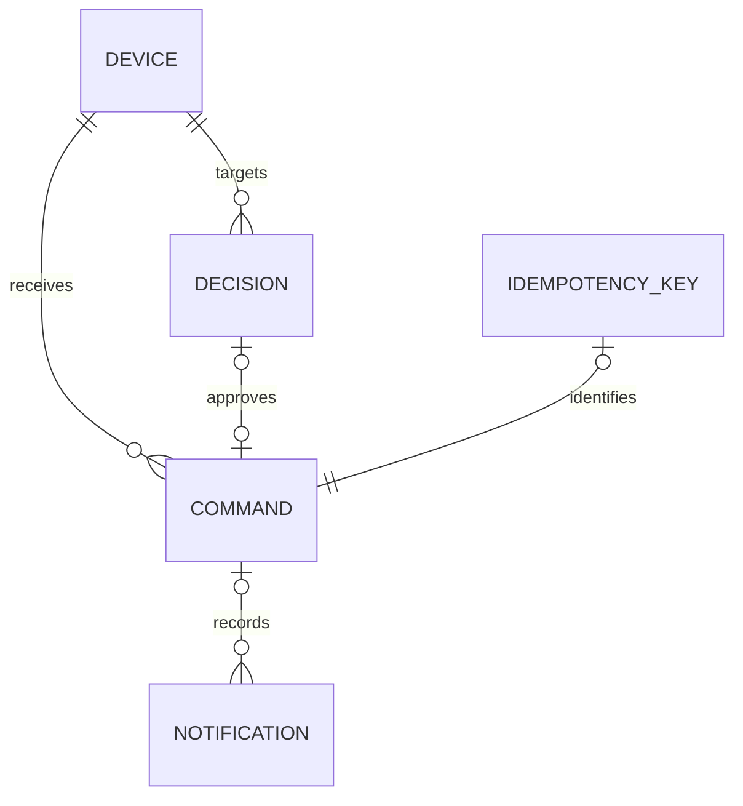

# 데이터 저장 구조

범위는 단일 세대, Cloud Server 한 프로세스입니다. 메모리 어댑터는 데모/테스트, PostgreSQL 어댑터는 실모드에 사용합니다.

| 실제 테이블 | 키 | 내용 |
|---|---|---|
| sensor_readings | measured_at timestamptz | 온도·습도·CO₂·PM2.5·PM10 수치 |
| prediction | generated_at timestamptz | 1시간 뒤 실내 온습도 예측 한 회분(metrics JSONB), 모델 버전, 선제 제어 사용 여부 |
| recommendation | id text | 기준값 추천 한 건과 처리 상태(payload JSONB) |
| room_state | id = room-1 | payload JSONB, updated_at |

room_state에는 devices, confirmedDevices, edge, settings, commands, decisions, notifications, idempotency, recovery와 Legacy 이벤트 중복 차단 기록을 함께 저장합니다. 작은 단일 세대 상태를 원자적으로 저장하기 위한 구조이며 정규화된 여러 관계 테이블로 구현했다고 주장하지 않습니다.

논리 관계는 다음과 같습니다.

위 객체들은 현재 JSONB 내부에 저장되며 SQL 외래키는 없습니다. 트랜잭션 순서를 서비스 큐로 직렬화하고, 상태 저장 성공 후에만 WebSocket 이벤트와 MQTT 명령을 내보냅니다. 센서 원본 INSERT와 room_state 저장은 별도이므로 장애 시 센서 한 행만 먼저 저장될 수 있습니다. 재시작 시 latest를 센서 테이블에서 복원합니다.

재시작 시 엣지는 offline, 미완료 명령은 결과 미확인 FAILED로 바뀌며 자동 재전송하지 않습니다. ACK 없이 장치 상태를 성공으로 바꾸지 않습니다. timestamp는 timestamptz/UTC ISO이며 센서 중복은 측정 시각으로 차단합니다. 서로 다른 센서 스트림이 같은 측정 시각을 공유할 수 있는 다세대 확장은 현재 범위 밖입니다.

이력 버킷은 UTC epoch 기준이며 측정값 산술평균을 계산합니다. 현재 진행 중인 버킷을 포함해 최대 60/288/168개를 반환합니다. 데이터가 없는 버킷은 0이나 직전 값으로 채우지 않습니다.

완료 명령·추천·알림은 각각 최근 1,000개, 미완료 항목은 별도 유지합니다. Idempotency-Key는 24시간/최대 10,000개이며 동일 키·동일 명령에는 최초 응답을 그대로 반환합니다. 동일 키·다른 명령은 409입니다. sensor_readings는 자동 삭제하지 않습니다. 운영 전 보존 기간, 백업, 장기 감사 이력, DB 잠금 기반 다중 인스턴스 설계를 정해야 합니다.
